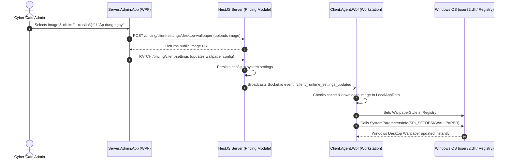

# Design Specification: Workstation Desktop Wallpaper Synchronization

**Date:** 2026-11-07  
**Status:** Approved by User  
**Author:** Antigravity  

---

## 1. Overview & Problem Statement

Currently, the **Server Admin App** provides a **"Cài đặt hình nền"** (Wallpaper Settings) tab, but it exclusively manages the **Lock Screen** media slideshow (displayed only when workstations are in the "Ready / Waiting for Login" state).

Cyber cafe owners frequently need to establish a consistent brand identity across the entire shop by enforcing a unified **Windows Desktop Wallpaper** (e.g., cyber logo, gaming tournament artwork, promo banners) whenever workstations are running and during active player sessions.

This feature introduces centralized management and automatic realtime synchronization of the **Windows Desktop Wallpaper** from Server Admin to all client workstations.

---

## 2. Architecture & Data Flow



---

## 3. Detailed Component Specifications

### 3.1. Server Admin App (`Server.Admin.App`)

* **Location:** `MainWindow.xaml` under `TabItem Header="Cài đặt hình nền"`.
* **New UI Group:** Dedicated section placed below the Lock Screen card:
  * **Header:** `🖼️ Hình nền Desktop Windows máy trạm (Desktop Wallpaper)`
  * **Controls:**
    * `CheckBox x:Name="DesktopWallpaperEnabledCheckBox"`: `[x] Bật đồng bộ hình nền Desktop cho máy trạm`.
    * `Button x:Name="ChooseDesktopWallpaperButton"`: `📂 Chọn ảnh từ máy tính...` (Filters: `*.jpg;*.jpeg;*.png;*.webp;*.bmp`).
    * `TextBox x:Name="DesktopWallpaperUrlTextBox"`: Displays the active media URL or UNC/local path (read-only or manual override).
    * `Image x:Name="DesktopWallpaperPreviewImage"`: 16:9 preview box with rounded border (`CornerRadius="8"`) and placeholder when empty.
    * `ComboBox x:Name="DesktopWallpaperStyleComboBox"`:
      * `fill`: Cắt tràn màn hình (Mặc định - Khuyên dùng)
      * `fit`: Vừa vặn khung hình
      * `stretch`: Kéo giãn toàn màn hình
    * `Button x:Name="ApplyDesktopWallpaperNowButton"`: `⚡ Áp dụng ngay cho máy trạm online` (Triggers immediate realtime broadcast).
    * `TextBlock x:Name="DesktopWallpaperStatusTextBlock"`: Informs user of upload status, save confirmation, and realtime dispatch count.

### 3.2. Backend (`NestJS` - Module `pricing`)

* **Configuration Storage:** Stored in database table `SystemSetting` via `PricingService`:
  * Key `__CLIENT_DESKTOP_WALLPAPER_ENABLED__`: `'true' | 'false'` (default: `'false'`).
  * Key `__CLIENT_DESKTOP_WALLPAPER_URL__`: string (URL pointing to stored wallpaper).
  * Key `__CLIENT_DESKTOP_WALLPAPER_STYLE__`: `'fill' | 'fit' | 'stretch'` (default: `'fill'`).
* **Endpoints:**
  * `GET /pricing/client-settings`: Includes `desktopWallpaperEnabled`, `desktopWallpaperUrl`, `desktopWallpaperStyle`.
  * `PATCH /pricing/client-settings`: Accepts `desktopWallpaperEnabled`, `desktopWallpaperUrl`, `desktopWallpaperStyle`.
  * `POST /pricing/client-settings/desktop-wallpaper`: Multi-part upload endpoint accepting image files up to 25MB (`.jpg`, `.png`, `.webp`, `.bmp`), saved into `uploads/wallpapers/` with unique filenames, served statically.
  * `POST /pricing/client-settings/desktop-wallpaper/apply-now`: Emits realtime socket event to force connected clients to re-apply wallpaper immediately.
* **Socket Event:**
  * Broadcast `client_runtime_settings_updated` with full payload, or `desktop_wallpaper_apply` on the realtime gateway.

### 3.3. Client Agent (`Client.Agent.Wpf`)

* **Local Cache Directory:** `%LocalAppData%\ServerManagerBilling\Cache\Wallpapers\`
* **Execution Logic:**
  1. When client boots or receives `client_runtime_settings_updated` / `desktop_wallpaper_apply`:
  2. If `desktopWallpaperEnabled == false`, ignore or preserve existing Windows wallpaper.
  3. If `desktopWallpaperEnabled == true` and `desktopWallpaperUrl` is valid:
     - Check if file exists in cache (using SHA256 or sanitized filename from URL). If missing or changed, download asynchronously.
     - Set Windows Registry keys under `HKEY_CURRENT_USER\Control Panel\Desktop`:
       - `WallpaperStyle`:
         - `fill`: `"10"`
         - `fit`: `"6"`
         - `stretch`: `"2"`
       - `TileWallpaper`: `"0"`
     - Invoke Win32 API:
       ```csharp
       [DllImport("user32.dll", CharSet = CharSet.Auto)]
       private static extern int SystemParametersInfo(int uAction, int uParam, string lpvParam, int fuWinIni);
       private const int SPI_SETDESKWALLPAPER = 20;
       private const int SPIF_UPDATEINIFILE = 0x01;
       private const int SPIF_SENDWININICHANGE = 0x02;
       ```
     - Apply when:
       * Client agent starts up and connects to backend.
       * Session login or unlock occurs.
       * Session finishes / returns to ready state.
       * Realtime push message arrives.

---

## 4. Error Handling & Edge Cases

1. **Large or Corrupt Images:** Backend enforces 25MB cap and validates MIME type (`image/jpeg`, `image/png`, `image/webp`, `image/bmp`).
2. **Network Interruption on Client:** Client downloads to temporary file (`.tmp`) and only replaces cached wallpaper on full download completion.
3. **Offline Machines:** When offline machines boot up later, their startup handshake (`GET /pricing/client-settings`) automatically applies the current wallpaper.
4. **Desktop Wallpaper Setting Disabled:** If admin unchecks the feature, client leaves current wallpaper untouched without errors.

---

## 5. Verification Plan

1. **Backend Verification:**
   - Test `GET /pricing/client-settings` returns new fields.
   - Test `POST /pricing/client-settings/desktop-wallpaper` uploads file and returns reachable URL.
   - Test `PATCH /pricing/client-settings` persists values.
2. **Admin App Verification:**
   - Open Tab **Cài đặt > Cài đặt hình nền**.
   - Pick an image file, verify preview renders, click Save.
   - Click "Áp dụng ngay cho máy trạm online" and observe status text.
3. **Client Agent Verification:**
   - Verify client logs show wallpaper received, downloaded to cache, and applied via `SystemParametersInfo`.
